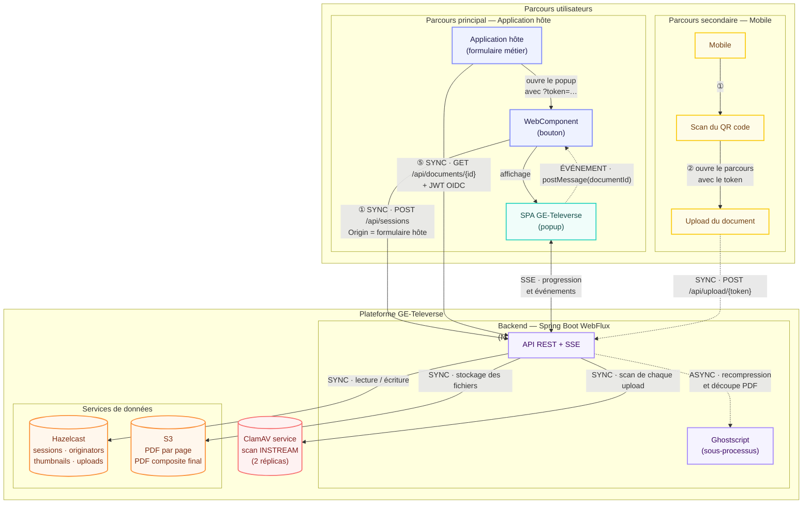

# GE-Televerse-Back

Backend du composant GE-Televerse — service de téléversement de documents par scan mobile pour les formulaires en ligne de l'État de Genève.

## Principe

GE-Televerse permet à un usager de scanner un document papier depuis son téléphone et de le rattacher directement à un formulaire en ligne ouvert sur son ordinateur. Le flux est le suivant :

1. L'application hôte intègre un **web component** (bouton). Au clic, celui-ci ouvre un popup vide de façon **synchrone** (hors du geste utilisateur, le navigateur le bloquerait), puis appelle **lui-même `POST /api/sessions` depuis la page hôte**.
2. C'est donc le navigateur qui estampille l'`Origin` **réel du formulaire** sur la création de session — infalsifiable côté usager, et c'est lui qui gouverne le profil de taille côté serveur. Le web component redirige ensuite le popup vers le **SPA GE-Televerse** en lui passant le token reçu (`?token=…`).
3. Le SPA affiche le **QR code** pointant l'`uploadUrl` renvoyée.
4. L'usager scanne le QR code avec son téléphone, ce qui ouvre la page d'upload mobile.
5. L'usager prend des photos ou sélectionne des fichiers — ceux-ci sont envoyés au backend.
6. Le backend **scanne le fichier via ClamAV**, puis le **convertit en PDF** (redimensionnement, compression, recompression et découpe Ghostscript des PDF multi-pages), stocke chaque page dans **S3** et notifie le SPA en temps réel via **Server-Sent Events (SSE)**.
7. L'usager revient sur le SPA desktop pour réviser, réordonner, éditer (rotation, balance des blancs, correction de perspective) et finaliser la session.
8. Le SPA transmet le `documentId` du PDF final au web component via **`window.postMessage()`**, qui émet un événement DOM vers l'application hôte.
9. L'application hôte récupère le PDF via **`GET /api/documents/{documentId}`** en présentant un **JWT OIDC** (audience `AEL.TELEVERSE`). Cet appel est *one-shot* : le PDF est supprimé de S3 dès que la réponse a été envoyée avec succès.

> **Qui crée la session.** C'est le **web component, sur la page hôte** — pas le SPA. Ce déport est délibéré : la création est le seul point où l'`Origin` du formulaire métier est visible, et le profil de taille en est dérivé (cf. [Créer une session](#créer-une-session)). Le SPA, ouvert sur le domaine `televerser.<env>`, ne verrait que son propre `Origin` et ne pourrait plus distinguer les formulaires entre eux.

## Architecture



Les deux appels qui ne partent pas du SPA sont ceux qui portent l'identité de l'application hôte :

- **① `POST /api/sessions`** — émis par le **webcomponent**, depuis la page hôte. C'est l'appel qui porte l'`Origin` du formulaire métier.
- **⑤ `GET /api/documents/{documentId}`** — émis par l'**application hôte** avec son JWT OIDC, après réception du `documentId` en ④.

### Distribution multi-pods

Le backend tourne derrière un load balancer **sans affinité de session**, sur plusieurs pods. Deux conséquences dictent toute l'architecture d'état : la connexion SSE vit sur **un** pod alors que l'upload du téléphone peut arriver sur **n'importe quel autre**, et le disque local d'un pod n'est jamais lisible par ses voisins. Tout ce qui doit survivre à un changement de pod passe donc par **Hazelcast** (client en prod, instance embarquée en dev).

Quatre structures distribuées, chacune pour un rôle distinct :

| Structure | Nom | Contenu | Rôle |
|---|---|---|---|
| `IMap` | `televerse-sessions` | `HazelcastJsonValue` | État de session (pages, quotas, TTL) |
| `IMap` | `televerse-originators` | `OriginatorBinding` | Verrou « une session par IP d'origine » |
| `IMap` | `televerse-thumbnails` | `byte[]` | Cache des vignettes de pages |
| `ITopic` | `televerse-uploads` | `UploadEvent` | Fan-out cross-pod des événements SSE |

**`televerse-sessions` — l'état de session.** Les sessions sont stockées en `HazelcastJsonValue`, pas en objets sérialisés : aucune classe applicative n'a alors besoin d'être déployée sur le classpath des membres du cluster. Les mutations concurrentes (attacher une page, réordonner, éditer) passent par `IMap.lock(token)`, qui sérialise cluster-wide. Ce verrou est **thread-affine** côté Hazelcast — le `unlock` doit venir du thread qui a pris le lock — d'où l'exécution de la section critique sur un `Schedulers.boundedElastic()` dédié plutôt que sur l'event loop Netty. Un listener `entryExpired` / `entryEvicted` intercepte les sessions qui meurent en silence (onglet tué sans `DELETE`) pour purger leurs pages S3 : sans lui, la liste des clés disparaîtrait avec l'entrée et les objets resteraient orphelins.

**`televerse-originators` — le verrou par poste.** `POST /api/sessions` extrait l'IP d'origine du header `X-Forwarded-For` posé par le firewall d'État (edge de confiance unique ; pas de fallback sur l'IP TCP, qui serait celle du firewall) et la lie à la session via `putIfAbsent(ip, binding, ttl)` — atomique cluster-wide, sérialisé par le partition owner. Une deuxième création depuis la même IP reçoit un `409 ORIGINATOR_HAS_ACTIVE_SESSION` tant que la première n'est ni finalisée, ni supprimée, ni expirée. Le TTL du binding est aligné sur celui de la session, et l'échec d'écriture de la session compense en supprimant le binding — sinon l'IP resterait bloquée sans session associée.

**`televerse-thumbnails` — un cache, pas une source de vérité.** Les vignettes (120 px, ~8 ko) sont l'objet le plus lu du flux : une requête par page à chaque ouverture de la liste, pour un contenu qui ne survit pas à la session. Les servir depuis S3 chargeait le lien vers le stockage objet d'un trafic sans rapport avec la valeur livrée (le PDF composite), et c'est ce trafic qui décrochait vers 4000 usagers simultanés — sockets coupées, 404 suspects. Hazelcast était déjà sur le chemin critique pour l'état de session : y poser les vignettes n'ajoute pas de dépendance, et l'`IMap` distribué garantit qu'une vignette écrite par le pod qui a reçu l'upload reste lisible par le pod qui sert la requête suivante. Toute vignette étant reconstructible depuis le PDF de la page (qui, lui, reste sur S3), un défaut de cache — TTL, éviction, cluster injoignable — coûte une régénération, jamais une erreur.

**`televerse-uploads` — le fan-out SSE.** Quand un upload arrive sur le pod B, l'événement est publié sur le topic ; le pod A, qui détient le sink SSE du navigateur, le reçoit et le pousse. Chaque pod ne réagit qu'aux tokens dont il détient effectivement un sink.

> **Configuration des maps : côté cluster, pas côté application.** Un client Hazelcast ne peut pas déclarer de `map` (`getConfig()` lève `UnsupportedOperationException` en mode client). Le `backup-count` et l'éviction de `televerse-thumbnails` doivent donc être posés sur les **membres** du cluster — cf. le commentaire en tête de `hazelcast-client.yaml`, qui porte le bloc à recopier. Sans lui le cache fonctionne quand même (défauts Hazelcast : `backup-count: 1`, pas d'éviction), mais l'empreinte double et rien ne borne la croissance sous pic. Le TTL par entrée, lui, est posé à l'écriture par `ThumbnailCacheService` et ne dépend d'aucune configuration cluster.

### Antivirus (ClamAV)

Chaque upload est scanné avant tout traitement : `UploadController` appelle `AntivirusService.scan(...)` juste après la mise en tampon du fichier, **avant** la branche image/PDF — un seul scan par upload, quel que soit le type. Un fichier infecté est rejeté en `422 INFECTED_FILE` et n'atteint jamais S3.

**Service partagé, pas sidecar.** ClamAV est déployé comme service à part (`clamav-svc`, 2 réplicas pour la HA) et non comme conteneur adjacent dans chaque pod applicatif. La base de signatures pèse plusieurs centaines de Mo résidents : la répliquer par pod coûtait ~30 Go de RAM sur le cluster. Le backend parle le protocole **INSTREAM** TCP natif de `clamd` (port 3310) — pas de partage de volume, pas d'écriture disque intermédiaire, le flux est poussé en mémoire.

**Fail-mode.** Un scan qui échoue pour raison *technique* (clamd injoignable, timeout, erreur protocole) est arbitré par `app.antivirus.fail-mode` :

| Mode | Comportement | Usage |
|---|---|---|
| `closed` (défaut prod) | `503 ANTIVIRUS_UNAVAILABLE` | Refuser plutôt que stocker un fichier non scanné |
| `open` | WARN + upload accepté | Dégradation maîtrisée, décision d'exploitation |

**Une infection avérée reste bloquée dans les deux modes** — le fail-mode n'arbitre que l'indisponibilité, jamais un verdict positif.

**Probe et re-résolution DNS.** Un PING au démarrage initialise l'état de disponibilité, puis un `@Scheduled` le rejoue toutes les `app.antivirus.probe-interval` et alimente la gauge `televerse.av.available` (0/1) — de quoi alerter sur un clamd tombé sans attendre le prochain upload. Deux pièges traités là :

- La lib `clamav-client` n'expose **pas de connect-timeout**. Un firewall qui blackhole les SYN (pas de RST) figerait le thread jusqu'au timeout TCP système, ~75 s. Chaque PING est donc enveloppé dans un `CompletableFuture` borné par `app.antivirus.timeout`.
- La lib **fige l'IP résolue** dans un `InetSocketAddress` à la construction et ne réinterroge jamais le DNS. Un pod clamd qui revient sur une nouvelle endpoint laisserait le client coincé sur l'ancienne. Le `ClamavClient` est donc **recréé à chaque probe en échec**, ce qui force une nouvelle résolution.

`app.antivirus.max-stream-size` (60 Mo) doit rester **≥ `app.limits.multipart-ceiling`** (50 Mo) et être aligné avec `StreamMaxLength` côté `clamd.conf` : en dessous, clamd tronque le flux en silence et rend un faux négatif. Le client ne pousse pas cette valeur au démon — c'est un contrat de configuration à tenir des deux côtés.

En dev, `app.antivirus.enabled: false` rend `scan(...)` no-op.

> **Tester avec EICAR.** La signature EICAR est un **hash HDB**, pas un pattern NDB : elle ne matche que si le fichier soumis est *exactement* la chaîne canonique de 68 octets. La coller dans le trailer d'un JPEG ou dans un flux PDF compressé ne déclenche rien — ce n'est pas une défaillance du scan. Passer par le fichier canonique, ou par un PDF à flux non compressé.

## Stack technique

| Composant | Technologie |
|---|---|
| Runtime | Java 21, Spring Boot 4.0, WebFlux (Netty) |
| Sécurité | Spring Security WebFlux + Resource Server OAuth2/JWT (OIDC) pour le proxy de récupération |
| Stockage | S3 (interne, compatible MinIO) via AWS SDK async |
| Cache / distribution | Hazelcast 5.4 (client en production, embedded en dev) — sessions, verrou originator, cache de vignettes, topic SSE |
| Conversion PDF | Apache PDFBox 3.x, Ghostscript (sous-processus) pour la recompression et la découpe |
| Antivirus | ClamAV — service partagé `clamav-svc`, protocole INSTREAM TCP natif (port 3310) |
| Traitement d'image | OpenCV 4.10 via bytedeco/javacpp-presets (balance des blancs, correction de perspective) |
| Détection de document | ONNX Runtime 1.20 + modèle DocAligner (DocsaidLab, Apache 2.0) — heatmap 4 coins |
| Monitoring | Actuator, Micrometer, Prometheus |
| Documentation API | Springdoc OpenAPI 3.1 (auto-générée) |

## API REST

### Créer une session

```
POST /api/sessions[?force=true]
Content-Type: application/json

{
  "sizeProfile": "M"
}
```

Appelé par le **web component depuis la page hôte** (cf. [Principe](#principe)), jamais par le SPA — c'est ce qui rend l'`Origin` du formulaire métier visible du backend.

Le corps est optionnel, et `sizeProfile` y est **ignoré** : le profil de taille est dérivé côté serveur du header `Origin` (whitelist `app.session-create.profiles`, défaut `S`) — la valeur du corps n'est jamais consultée (un usager pourrait l'éditer et s'auto-augmenter son quota). Le champ est conservé pour compatibilité ascendante. L'isolation des sessions est garantie par le token UUID renvoyé : chaque clic sur le bouton du web component crée une nouvelle session indépendante.

Le backend exige un header `Origin` valide (posé d'office par les navigateurs sur tout `POST`, infalsifiable en JS) : **c'est lui qui gouverne le profil de taille**. Un appel non-navigateur sans `Origin` reçoit `400`. CORS + le verrou same-origin n'autorisent la création cross-origin (le web component appelle l'API depuis la page hôte) que depuis le realm configuré (`app.session-create.allowed-origin-suffixes`).

**Réponse :**

```json
{
  "token": "a1b2c3d4-...",
  "uploadUrl": "https://ge-televerse.app.ge.ch/scan/a1b2c3d4-...",
  "expiresAt": 1708099200000,
  "sizeProfile": "M",
  "maxTotalBytes": 15728640,
  "maxPages": 20
}
```

Le `uploadUrl` (`https://<Host>/scan/<token>`) pointe l'hôte qui sert la SPA et le mobile, pour la prise en main mobile. Il est construit sur le header `Host` et **non** sur l'`Origin` : depuis que le web component crée la session depuis la page hôte, l'`Origin` est celui du formulaire (cross-origin), pas celui de la SPA.

**Une session à la fois par poste.** Si `app.originator.enabled` est actif (défaut), l'IP d'origine lue dans `X-Forwarded-For` est liée à la session (cf. [`televerse-originators`](#distribution-multi-pods)). Une seconde création depuis la même IP est refusée tant que la première vit. Le front propose alors un bouton « j'ai fermé l'autre fenêtre » qui rejoue l'appel avec `?force=true` : la session bloquante est purgée côté serveur avant création de la nouvelle.

| Code HTTP | `errorCode`                     | Cause                                                          |
|-----------|---------------------------------|----------------------------------------------------------------|
| `400`     | —                               | Header `Origin` ou `Host` absent (appel non-navigateur)         |
| `400`     | `MISSING_ORIGINATOR`            | Header `X-Forwarded-For` absent alors que le verrou est actif   |
| `400`     | `INVALID_ORIGINATOR`            | `X-Forwarded-For` non parsable comme adresse IP                 |
| `409`     | `ORIGINATOR_HAS_ACTIVE_SESSION` | Une session est déjà active pour cette IP (`expiresAt` renvoyé) |
| `429`     | `SESSION_RATE_LIMITED`          | Rate-limit par IP dépassé (`Retry-After` renvoyé)               |

La réponse `409` expose l'`expiresAt` de la session bloquante pour permettre un compte à rebours, **mais jamais son token** : sur un NAT partagé, une IP voisine pourrait sinon deviner le token d'une session ouverte par un poste tiers.

### S'abonner aux événements (SSE)

```
GET /api/sessions/{token}/events
Accept: text/event-stream
```

Événements émis :

| Événement | Description |
|---|---|
| `connected` | Connexion établie, en attente d'upload |
| `upload-complete` | Un document a été téléversé et converti en PDF |
| `page-edited` | Une page a été éditée (rotation, deskew, crop, balance des blancs, undo, reset) |
| `page-deleted` | Une page a été supprimée |
| `pages-reordered` | Les pages ont été réordonnées |
| `phone-connected` | Le téléphone s'est connecté (QR scanné) |
| `phone-disconnected` | Le téléphone a terminé (bouton "Terminé") |
| `session-complete` | Session finalisée, PDF fusionné prêt |

Exemple de payload `upload-complete` :

```json
{
  "type": "upload-complete",
  "documentId": "a1b2c3d4-....pdf",
  "fileName": "scan.jpg",
  "contentType": "image/jpeg",
  "fileSize": 245000,
  "uploadedAt": "2025-02-16T14:30:00Z",
  "pageId": "page-003",
  "pageIndex": 2,
  "totalPages": 3,
  "totalBytes": 245000,
  "maxTotalBytes": 26214400
}
```

Les événements de mutation (`upload-complete`, `page-deleted`, `pages-reordered`) portent toujours `totalBytes` et `maxTotalBytes` pour permettre au SPA desktop de mettre à jour la barre de progression. `phone-connected`, `phone-disconnected` et `session-complete` n'utilisent que `documentId` (`totalBytes` à 0).

### Téléverser un document

```
POST /api/upload/{token}
Content-Type: multipart/form-data

file: (binaire)
```

**Réponse :**

```json
{
  "documentId": "a1b2c3d4-....pdf",
  "message": "Upload successful",
  "expiresAt": 1708099500000,
  "pageId": "page-003",
  "pageIndex": 2,
  "totalPages": 3,
  "thumbnailUrl": "/api/sessions/a1b2c3d4-.../pages/page-003/thumbnail?v=1708099500000",
  "sizeProfile": "S",
  "totalBytes": 245000,
  "maxTotalBytes": 26214400,
  "pagesAdded": 3,
  "errorCode": null
}
```

Formats acceptés : JPEG, PNG, PDF. Plafond : 50 Mo par fichier (`app.limits.multipart-ceiling`). Un PDF multi-pages est automatiquement découpé : chaque page devient une entrée indépendante avec sa propre vignette, éditable et réordonnable individuellement.

Le fichier est **scanné par ClamAV avant tout traitement** (cf. [Antivirus](#antivirus-clamav)) : ni un fichier infecté, ni un fichier non scanné en `fail-mode: closed` n'atteint S3.

En cas de rejet, `errorCode` discrimine la cause :

| Code HTTP | `errorCode`            | Cause                                                              |
|-----------|------------------------|--------------------------------------------------------------------|
| `400`     | `INVALID_MULTIPART`    | Plus d'un fichier dans l'envoi, ou corps multipart mal formé        |
| `413`     | `FILE_TOO_LARGE`       | Fichier au-delà de 50 Mo, refusé par le codec avant tout traitement |
| `413`     | `SESSION_SIZE_EXCEEDED`| Le quota cumulé de la session serait dépassé (rollback S3 effectué) |
| `409`     | `SESSION_FINALIZING`   | Session en cours de finalisation (ou `SESSION_FINALIZED` : finalisée) — plus aucune page acceptée |
| `422`     | `INFECTED_FILE`        | ClamAV a détecté une signature — le fichier est écarté              |
| `422`     | `CORRUPT_FILE`         | Fichier illisible ou endommagé (décodage impossible)                |
| `429`     | `PAGE_LIMIT_REACHED`   | `maxPages` atteint                                                 |
| `429`     | `PDF_TOO_MANY_PAGES`   | PDF multi-pages plus volumineux que les slots restants             |
| `429`     | `UPLOAD_BUSY`          | Bulkhead d'admission upload saturé (`Retry-After`)                  |
| `503`     | `ANTIVIRUS_UNAVAILABLE`| clamd injoignable et `fail-mode: closed` (`Retry-After`)            |
| `503`     | `STORAGE_UNAVAILABLE`  | Défaillance transitoire S3 (pool saturé, 5xx, reset TLS)            |

### Traitement d'image post-upload

Quatre traitements sont déclenchables à la demande sur une page déjà uploadée (bouton UI). Chacun écrit une **nouvelle version** de la page (PDF sur S3, vignette dans le cache) sous des clés neuves, que la session adopte ensuite sous verrou : rien d'existant n'est réécrit, et une édition refusée — page supprimée ou modifiée entre-temps (`409 PAGE_GONE` / `PAGE_CHANGED`), quota dépassé (`413 SESSION_SIZE_EXCEEDED`), session en finalisation (`409 SESSION_FINALIZING`) — n'a aucun effet. Cf. [Conflits de session](docs/api.md#conflits-de-session).

Balance des blancs, correction de perspective et recadrage reconstruisent la page à partir de son image : ils ne s'appliquent qu'aux pages qui se réduisent à une image — photos, pages numérisées. Sur une page de PDF portant du texte, des tracés vectoriels ou plusieurs images, ils répondent `422 PAGE_NOT_EDITABLE` sans rien modifier ; la rotation (métadonnée `/Rotate`, sans perte) reste possible partout.

```
POST /api/sessions/{token}/pages/{pageId}/white-balance   # balance des blancs
POST /api/sessions/{token}/pages/{pageId}/deskew           # correction de perspective
POST /api/sessions/{token}/pages/{pageId}/crop             # recadrage automatique
POST /api/sessions/{token}/pages/{pageId}/rotate?direction=cw|ccw  # rotation 90°
```

Chaque édition est rejetée en `429 EDIT_BUSY` (avec `Retry-After`) si le bulkhead d'admission dédié est saturé — une édition pèse une lecture et une écriture S3, un rendu PDFBox et une vignette, donc autant qu'un upload sur le pool de connexions.

#### Annuler une édition

```
POST /api/sessions/{token}/pages/{pageId}/undo             # annuler la dernière édition
POST /api/sessions/{token}/pages/{pageId}/reset            # revenir à l'état d'upload initial
```

Deux niveaux d'annulation, adossés à deux versions conservées de la page :

- **`undo`** revient à la version *précédente*, celle que la dernière édition a supplantée. Un seul cran en arrière.
- **`reset`** (« Annuler tout ») revient à la version *initiale* — en général celle de l'upload — et oublie les deux.

Aucune copie : la page pointe de nouveau sur les clés de la version visée, et les versions abandonnées sont purgées une fois le changement adopté par la session.

Les deux sont **idempotents** : sans sauvegarde disponible (page jamais éditée, ou déjà réinitialisée) ils répondent `200` sans rien modifier. La réponse porte `undoAvailable`, qui indique au front s'il doit garder le bouton actif. Une page inconnue donne `404`, une session expirée `400`.

### Gestion des pages

```
DELETE /api/sessions/{token}/pages/{pageId}                # supprimer une page
PUT    /api/sessions/{token}/pages/order                   # réordonner les pages
GET    /api/sessions/{token}/pages/{pageId}/thumbnail      # vignette 120px (liste)
GET    /api/sessions/{token}/pages/{pageId}/thumbnail?width=800  # preview (popover édition)
GET    /api/sessions/{token}/preview.pdf                   # aperçu PDF composite (avant finalisation)
```

L'endpoint `preview.pdf` fusionne les pages courantes en mémoire et renvoie le résultat (`Content-Disposition: inline`). Idempotent, sans upload S3 ni suppression — peut être rappelé pendant que de nouvelles pages arrivent. Les aperçus multi-pages (`preview.pdf` et le rendu de vignette à la volée) ont leur propre bulkhead : saturation → `429 MERGE_BUSY`.

Toutes les mutations (delete, reorder, rotate, deskew, crop, white-balance, undo, reset) renvoient le `expiresAt` renouvelé pour que le client puisse synchroniser sa vue du TTL sans appel séparé à `keep-alive`.

### Session multi-device

```
POST /api/sessions/{token}/keep-alive                      # prolonge la session (bouton "Rester connecté")
POST /api/sessions/{token}/phone-connect                   # téléphone connecté → SSE phone-connected
POST /api/sessions/{token}/phone-disconnect                # téléphone terminé  → SSE phone-disconnected
```

Le SPA desktop grise son interface à la réception de `phone-connected` et la réactive à `phone-disconnected`. L'état `phoneConnected` est persisté dans la session et visible via `GET /sessions/{token}` pour la reconnexion SSE.

### Consulter une session

```
GET /api/sessions/{token}
```

Retourne les détails de la session (incluant `phoneConnected`) ou 404 si expirée/inexistante.

### Finaliser une session

```
POST /api/sessions/{token}/finalize
```

Fusionne toutes les pages individuelles en un PDF composite unique sur S3, puis émet l'événement SSE `session-complete` portant le `documentId` — celui que le SPA relaie au web component, et que l'application hôte présentera à `GET /api/documents/{documentId}`.

**Réponse :**

```json
{
  "documentId": "a1b2c3d4-....pdf",
  "message": "Session finalized"
}
```

Pendant la fusion, la session est figée (`FINALIZING`) : upload, édition, suppression et réordonnancement répondent `409 SESSION_FINALIZING`. Une fois le PDF composite écrit, la session passe en `FINALIZED` et rend ses ressources : pages et versions d'undo sont purgées de S3 en best effort (le lifecycle du bucket reste le filet ultime), leurs vignettes du cache Hazelcast. Une finalisation rejouée rend le même `documentId` ; une fusion en échec ou hors délai rouvre la session.

| Code HTTP | `errorCode` | Condition |
|---|---|---|
| `200` | — | PDF composite écrit, `session-complete` émis |
| `400` | — | Session expirée/inexistante, ou aucune page à fusionner |
| `429` | `FINALIZE_BUSY` | Bulkhead de finalisation saturé, ou autre finalisation de la session en cours (`Retry-After`) |
| `504` | — | Fusion au-delà de `app.finalize-timeout` (2 min) ; session rouverte |

La finalisation a son **propre** bulkhead, distinct de celui des aperçus : elle retient un permis bien plus longtemps (jusqu'à `app.finalize-timeout`, 2 min), et les regrouper affamerait les aperçus interactifs.

### Supprimer une session

```
DELETE /api/sessions/{token}
```

Appelé par le front sur `beforeunload` via `navigator.sendBeacon`. Libère le binding originator (l'IP peut immédiatement rouvrir une session), ferme le sink SSE local et purge les pages orphelines sur S3 en best-effort.

**Idempotent** : répond `204` même si la session n'existe plus — le navigateur peut émettre `beforeunload` plusieurs fois.

### Récupération du PDF final (proxy OIDC)

```
GET /api/documents/{documentId}
Authorization: Bearer <JWT>
```

Endpoint dédié aux **applications hôtes** (formulaires métier de l'État) pour récupérer le PDF composite après finalisation. Le `documentId` est celui reçu via l'événement SSE `session-complete` et relayé par le SPA au web component (puis transmis à l'app hôte côté DOM).

**Authentification :** JWT validé via JWKS (env vars `JWK_SET_URI` / `ISSUER_URI`). Le claim `aud` doit contenir `AEL.TELEVERSE`. Toute autre route reste `permitAll` côté Spring Security — le verrou same-origin habituel s'applique via CORS.

**Réponse 200 :** corps binaire `application/pdf` (`Content-Disposition: attachment; filename="document.pdf"`).

**Consommation unique :** dès l'écriture réussie de la réponse, le PDF est supprimé sur S3. Un second appel renvoie `410 Gone`. Si l'écriture échoue (déconnexion client), la suppression n'a pas lieu et un retry peut réussir.

| Code HTTP | Condition |
|---|---|
| `200` | Succès, PDF streamé, suppression S3 effectuée |
| `400` | `documentId` ne respecte pas le format `<uuid>.pdf` |
| `401` | JWT absent, expiré, mal signé ou audience invalide |
| `410` | Document déjà consommé ou inexistant sur S3 |

CORS : route ouverte à toutes les origines (la frontière de sécurité est le JWT, pas le header Origin).

### Documentation API complète

Voir `docs/api.md` et la spécification OpenAPI générée dans `docs/openapi/`.

L'application déployée ne sert **pas** de Swagger UI : springdoc, qui la
fournissait, amenait Jackson 2 (par swagger-core) dans le jar de production. Il
n'est plus sur le classpath que sous le profil Maven `openapi-generation`, qui
régénère `docs/openapi/` :

```bash
mvn -f public/pom.xml verify -Popenapi-generation -Dopenapi-generation=true -Drevision=X.Y.Z
```

Swagger UI en local, sur les mêmes bases :

```bash
mvn -f public/pom.xml spring-boot:run -Dopenapi-generation=true -Dspring-boot.run.profiles=dev,openapi
# puis http://localhost:8080/api/swagger-ui.html
```

## Conversion PDF et traitement d'image

Tous les documents téléversés sont convertis en **un PDF par page**, puis fusionnés à la finalisation :

- **Images** (JPEG, PNG) : redimensionnées à max 1754px (A4 à 150 DPI), compressées en JPEG à 75% de qualité, insérées centrées sur une page A4 avec marges de 0.5 pouce. Une vignette JPEG (120px) est générée en parallèle.
- **PDF mono-page** : recompressé si utile (cf. Ghostscript ci-dessous), stocké avec génération de vignette.
- **PDF multi-pages** : recompressé **et** découpé en pages individuelles en une seule passe Ghostscript. Chaque page est stockée séparément avec sa propre vignette, indépendamment éditable et réordonnable.
- **Finalisation** : toutes les pages individuelles sont fusionnées en un document PDF unique sur S3.

### Recompression et découpe (Ghostscript)

Ghostscript est invoqué en **sous-processus** (binaire résolu via le `PATH`, `gswin64c` sur le profil dev Windows) pour deux usages : recompresser un PDF entrant, et découper un PDF multi-pages en pages autonomes.

**Pourquoi gs plutôt que PDFBox pour la découpe.** `Splitter` de PDFBox casse l'encodage des polices en sous-ensemble — les accents ressortent en caractères parasites (`é` → `Ø`) — et abîme les flux ICC. Le découpage passe donc par gs (`recompressAndSplitToPages`), qui produit des pages autonomes propres. Le chemin PDFBox subsiste en **repli** : PDF mono-page, ou gs indisponible (typiquement en dev local sans binaire installé). Un rendu validé sous gs ne prouve rien — gs est tolérant ; contrôler avec un lecteur strict.

**Garde-fous.** La recompression est cadrée pour ne jamais faire échouer un upload :

| Garde-fou | Effet |
|---|---|
| Sonde `--version` au démarrage | Binaire absent → le service rend le PDF d'origine, sans bloquer |
| Seuil `size-threshold` (200 Ko) | En dessous, le gain ne paie pas l'overhead du processus : PDF laissé intact |
| Scheduler borné (`workers`, `queue-size`) | Au plus N processus `gs` concurrents ; au-delà de la file, repli sur l'original |
| `timeout` (PT15S) | `gs` est tué, l'original est conservé |
| Comparaison de taille | Sortie plus grosse que l'entrée (PDF déjà optimisé, vectoriel) → on garde l'original |

**Calibrage des workers.** `app.ghostscript.workers` suit la règle `vCPU - 1` (12 en preprod). Le dimensionnement se vérifie sur `televerse.gs.peak.rss.bytes` (peak RSS max d'un processus depuis le démarrage du pod, via `/proc/<pid>/status:VmHWM`) rapporté à la limite mémoire du pod, et sur `televerse.gs.current.rss.bytes` pour la pression instantanée. `televerse.gs.queue.depth` signale une file qui sature, donc des recompressions abandonnées.

> **Preset et transparence.** `pdf-settings: /ebook` fournit les défauts, mais les presets `screen` / `ebook` / `printer` **aplatissent la transparence et suppriment les groupes de transparence**. Le service force donc `-dColorConversionStrategy=/LeaveColorUnchanged`, et surcharge la résolution à `image-resolution-dpi: 300` (le preset plafonne à 150 DPI, trop agressif) pour rester homogène avec `app.image.dpi` du chemin image→PDF. Toute évolution de ces réglages se valide **sur le rendu**, pas sur la taille du fichier produit.

### Traitements post-upload (à la demande)

- **Rotation** — 90° horaire ou anti-horaire (Java 2D).
- **Balance des blancs** — neutralise les dominantes colorées (éclairage tungstène, néon) via OpenCV `SimpleWB` (module `xphoto`).
- **Correction de perspective** — détecte les 4 coins du document et le redresse (`warpPerspective`). Cascade à 4 étages :
  1. **DNN (DocAligner)** — modèle ONNX (lcnet100, ~4.7 MB embarqué) qui régresse les coins via une heatmap. Robuste à la perspective, aux plis, aux ombres ; échoue proprement (heatmap nulle) sur les images hors distribution.
  2. **Strict** — Canny + approxPolyDP epsilon=0.02 sur 4 sommets exactement.
  3. **Souple** — `MORPH_CLOSE` multi-noyaux + multi-epsilons + enveloppe convexe, score min appliqué.
  4. **minAreaRect** — rectangle de surface minimale autour du plus grand contour.

  Le DNN est tenté en premier ; les étages classiques servent de fallback. En cas d'échec de tous, l'image reste inchangée.
- **Recadrage automatique** — détecte le document (même cascade) et recadre sur son rectangle englobant, sans corriger la perspective (conserve les pixels originaux). Complémentaire au deskew.

Les traitements sont exécutés sur un scheduler `boundedElastic` pour ne pas bloquer l'event loop Netty. Les natives OpenCV sont embarquées dans le JAR via bytedeco/javacpp-presets (`linux-x86_64` pour la production, `windows-x86_64` via profil Maven pour le développement local).

## Configuration

Les propriétés principales sont dans `application.yml` sous le préfixe `app` :

| Propriété | Description | Défaut |
|---|---|---|
| `app.session-ttl` | Durée de vie des sessions (ISO-8601), repoussée à chaque activité | `PT5M` |
| `app.cleanup-interval` | Intervalle de nettoyage des sessions expirées (ISO-8601) | `PT1M` |
| `app.sse-heartbeat-interval` | Intervalle des heartbeats SSE (ISO-8601) | `PT15S` |
| `app.finalize-timeout` | Timeout pour la fusion PDF | `PT2M` |
| `app.thumbnail-width` | Largeur des vignettes en pixels | `120` |
| `app.limits.max-pages` | Nombre max de pages par session | `20` |
| `app.limits.multipart-ceiling` | Taille max d'un upload multipart | `50MB` |
| `app.limits.profiles.{S,M,L,XL}.max-total-size` | Taille max par profil | variable |
| `app.session-create.allowed-origin-suffixes` | Realm des hôtes autorisés à créer une session en cross-origin (création uniquement). Env var `APP_SESSION_CREATE_ALLOWED_ORIGIN_SUFFIXES` (CSV). | `.ge.ch`, `.etat-ge.ch` |
| `app.session-create.profiles` | Whitelist `suffixe d'hôte → profil de taille`, cf. [Profils de taille par origine](#profils-de-taille-par-origine) | vide (tout en `S`) |
| `app.cors.allowed-origins` | Origines autorisées pour les web components. Le fichier versionné ne déclare que l'origine de production ; les environnements non productifs ajoutent la leur via l'env var `APP_CORS_ALLOWED_ORIGINS` (CSV), qui **remplace** la liste. | origine de production |
| `app.originator.enabled` | Verrou « une session par IP d'origine » (IMap `televerse-originators`). `false` en dev et pour les tests de charge qui simulent plusieurs postes depuis une seule IP. | `true` |
| `app.thumbnail-cache.enabled` | Cache des vignettes sur l'IMap `televerse-thumbnails`. Coupe-circuit d'exploitation : à `false`, tout le trafic vignette repart en régénération à la volée, sans redéploiement. | `true` |
| `app.thumbnail-cache.ttl` | TTL d'une entrée de vignette. Doit rester nettement au-dessus de `app.session-ttl`, que l'activité repousse en continu — une vignette posée au premier upload doit survivre à une session prolongée par des éditions. | `PT30M` |
| `app.antivirus.enabled` | Probe, re-probe et scan INSTREAM de chaque upload. `false` en dev (no-op). | `true` |
| `app.antivirus.host` / `.port` | Service clamd (env `ANTIVIRUS_HOST` / `ANTIVIRUS_PORT`) | `clamav-svc` / `3310` |
| `app.antivirus.fail-mode` | `closed` → 503 si clamd KO ; `open` → WARN et upload accepté. Une infection avérée reste bloquée dans les deux cas. | `closed` |
| `app.antivirus.timeout` | Timeout du PING (probe et re-probe), borné hors de la lib qui n'expose pas de connect-timeout | `PT5S` |
| `app.antivirus.scan-timeout` | Timeout d'un scan INSTREAM. Distinct du PING : couvre le push de `max-stream-size` puis le scan. Trop court → 503 sur des uploads légitimes. | `PT30S` |
| `app.antivirus.max-stream-size` | Taille max du flux soumis à clamd. **≥ `app.limits.multipart-ceiling`**, et à aligner avec `StreamMaxLength` de `clamd.conf`. | `60MB` |
| `app.antivirus.probe-interval` | Période du re-probe PING (alimente `televerse.av.available`) | `PT30S` |
| `app.ghostscript.binary-name` | Binaire résolu via le `PATH` (`gswin64c` sur le profil dev) | `gs` |
| `app.ghostscript.workers` | Processus `gs` concurrents max. Règle : `vCPU - 1`. | `12` |
| `app.ghostscript.queue-size` | Profondeur de file du scheduler borné ; au-delà, repli sur le PDF original | `50` |
| `app.ghostscript.size-threshold` | En dessous, pas de recompression (gain marginal vs overhead) | `200KB` |
| `app.ghostscript.timeout` | Timeout par appel `gs` ; dépassement → `gs` tué, original conservé | `PT15S` |
| `app.ghostscript.pdf-settings` | Preset de base. Le service force en plus `-dColorConversionStrategy=/LeaveColorUnchanged`. | `/ebook` |
| `app.ghostscript.image-resolution-dpi` | Résolution du sous-échantillonnage, alignée sur `app.image.dpi` (le preset plafonnerait à 150) | `300` |
| `app.admission.{upload,edit,merge,finalize}.max-concurrent` | Bulkheads par pod → `429 *_BUSY` au-delà | `8` / `8` / `100` / `100` |
| `app.security.enabled` | Active la chaîne Spring Security (JWT sur `/api/documents/**`). `false` en dev pour le dev local. | `true` |
| `app.security.jwt-audience` | Valeur attendue dans le claim `aud` du JWT du proxy de récupération | `AEL.TELEVERSE` |
| `spring.security.oauth2.resourceserver.jwt.jwk-set-uri` | URL du JWKS du fournisseur d'identité (env `JWK_SET_URI`) | — |
| `spring.security.oauth2.resourceserver.jwt.issuer-uri` | Issuer attendu dans le claim `iss` (env `ISSUER_URI`) | — |

### Profils de taille par origine

Chaque session reçoit un profil de taille — un « tee-shirt size » — qui plafonne le
volume cumulé de ses pages (`app.limits.profiles`) :

| Profil | Volume max par session |
|---|---|
| `S` | 5 MB |
| `M` | 15 MB |
| `L` | 50 MB |
| `XL` | 200 MB |

Le nombre de pages est plafonné à part, par `app.limits.max-pages`, quel que soit le
profil.

Le profil n'est **jamais choisi par le client** : il est dérivé du header `Origin` de
`POST /api/sessions`, c'est-à-dire de l'hôte du formulaire qui embarque le web
component (cf. [Créer une session](#créer-une-session)). La correspondance se déclare
dans `app.session-create.profiles` :

```yaml
app:
  session-create:
    profiles:
      - { suffix: formulaire.demarches.etat-ge.ch, profile: XL }
      - { suffix: .demarches.etat-ge.ch,           profile: L }
      - { suffix: .ge.ch,                          profile: M }
```

Règles de résolution :

- **L'`Origin` tel que le backend le reçoit.** La comparaison porte sur le header
  `Origin` qui arrive au backend, après les reverse proxies et le routeur — pas sur
  l'adresse que l'usager voit dans son navigateur. Si un proxy réécrit le header,
  c'est la valeur réécrite qu'il faut déclarer. La source qui fait foi est la ligne
  de log décrite plus bas, qui trace la valeur exacte reçue.
- **Un suffixe d'hôte, pas une URL.** Le scheme et le port de l'`Origin` sont retirés
  avant la comparaison : une entrée `https://formulaire.demarches.etat-ge.ch` ne
  matchera jamais rien. Écrire l'hôte seul.
- **Frontière de label.** Le point initial est facultatif : `ge.ch` et `.ge.ch`
  matchent `x.ge.ch` et l'apex `ge.ch`, jamais `evil-ge.ch`. Un hôte complet vise donc
  cet hôte et ses sous-domaines.
- **Le plus spécifique gagne.** Quand plusieurs suffixes matchent, le plus long
  l'emporte, quel que soit l'ordre de la liste. Dans l'exemple,
  `formulaire.demarches.etat-ge.ch` obtient `XL`, `autre.demarches.etat-ge.ch` obtient
  `L`.
- **Hors liste → `S`.** Une origine absente de la liste reçoit `S` : jamais
  d'escalade implicite.
- **L'hôte doit aussi pouvoir créer.** Une entrée n'a d'effet que si l'hôte appartient
  au realm `app.session-create.allowed-origin-suffixes` (ou figure dans
  `app.cors.allowed-origins`). Sinon CORS refuse la création avant même que le profil
  soit résolu.

Le fichier versionné laisse la liste vide : les hôtes de formulaire diffèrent d'un
environnement à l'autre, et la liste se pose au déploiement par variables
d'environnement **indexées**, une paire `SUFFIX` / `PROFILE` par entrée :

```bash
APP_SESSIONCREATE_PROFILES_0_SUFFIX=formulaire.demarches.etat-ge.ch
APP_SESSIONCREATE_PROFILES_0_PROFILE=XL
APP_SESSIONCREATE_PROFILES_1_SUFFIX=.demarches.etat-ge.ch
APP_SESSIONCREATE_PROFILES_1_PROFILE=L
```

Les index partent de `0` et se suivent sans trou : un index sauté laisse les entrées
suivantes non bindées, et l'application refuse de démarrer
(`UnboundConfigurationPropertiesException`). Comme pour `APP_CORS_ALLOWED_ORIGINS`,
ces variables **remplacent** la liste du YAML au lieu de la compléter.

Pour repérer les formulaires à ajouter, le backend journalise en `INFO` chaque
création depuis une origine hors liste, avec l'`Origin` tel qu'il l'a reçu
(« Création de session depuis une origine hors whitelist de profils : https://… »).
C'est l'hôte de cette ligne qu'on reporte dans la liste. L'histogramme
`televerse.session.final.bytes`, taggé `sizeProfile`, montre si les volumes réels d'un
profil approchent son plafond.

Configuration S3 sous `spring.cloud.aws` :

| Propriété | Description |
|---|---|
| `spring.cloud.aws.s3.endpoint` | URL du endpoint S3 |
| `spring.cloud.aws.s3.bucket` | Nom du bucket |
| `spring.cloud.aws.credentials.access-key` | Clé d'accès (via variable d'env `S3_ACCESS_KEY`) |
| `spring.cloud.aws.credentials.secret-key` | Clé secrète (via variable d'env `S3_SECRET_KEY`) |

## Développement

### Prérequis

- Java 21+
- Maven 3.9+

### Lancer en local

```bash
mvn spring-boot:run -Dspring-boot.run.profiles=dev
```

Le profil `dev` permet de tourner l'app sans aucun service externe :
- **Hazelcast embarqué** (pas de cluster requis)
- **S3 simulé sur disque** via `FakeS3AsyncClient` (`~/.ge-televerse/s3-dev/`)
- **CORS permissif** (toutes origines)
- **Antivirus désactivé** (`app.antivirus.enabled: false`) — pas de clamd à faire tourner en local ; `scan(...)` est un no-op
- **Verrou originator désactivé** — un seul poste = une seule IP, donc la deuxième création de session dans la même fenêtre TTL déclencherait un `409` dès que le `beforeunload` n'a pas eu le temps de partir
- **Truststore factice** pour les bundles SSL non utilisés en local
- **Logs DEBUG** sur le code applicatif

Ghostscript n'est **pas** requis en local : sans binaire sur le `PATH`, la recompression est simplement sautée et la découpe multi-pages passe par PDFBox. Pour exercer le vrai chemin, installer Ghostscript (le profil dev cherche `gswin64c` sous Windows). Attention alors : le repli PDFBox abîme les polices en sous-ensemble, donc un test de découpe fait sans `gs` ne reflète pas la production.

Le `RestartClassLoader` de Spring Devtools est désactivé via les `jvmArguments` du plugin Maven pour éviter une `ClassCastException` Hazelcast au démarrage. Un lancement depuis IntelliJ conserve le hot reload.

### Lancer les tests

```bash
mvn test
```

Les tests sont des tests unitaires purs (Mockito, pas de contexte Spring) sauf `PdfServiceTest` (conversions PDFBox), `WhiteBalanceServiceTest` et `PerspectiveCorrectionServiceTest` (OpenCV réel, skippés si natives absentes), et `DocumentControllerTest` qui boote un `@SpringBootTest` (profil dev, Hazelcast embarqué, FakeS3) pour exercer la chaîne Spring Security + audience validator de bout en bout — clé RSA générée à la volée pour signer des JWT de test sans WireMock ni JWKS HTTP.

### Générer la spécification OpenAPI

```bash
mvn verify -Popenapi-generation -Dopenapi-generation=true -DskipTests
```

Le fichier produit est `docs/openapi/openapi-ge-televerse.yaml`.

### Lancer en conteneur

```bash
mvn -DskipTests package
docker build -t ge-televerse-back:dev .
docker run --rm -p 8080:8080 -p 9000:9000 -e SPRING_PROFILES_ACTIVE=dev ge-televerse-back:dev
```

Le [`Dockerfile`](Dockerfile) de ce dépôt part d'une image OpenJDK 21 publique et
installe Ghostscript. C'est une image de **développement** : elle permet d'exercer le
chemin Ghostscript réel sans l'installer sur son poste. L'image déployée en
production est construite ailleurs, à partir d'une base durcie — cf.
[Déploiement](#déploiement).

## Structure du projet

```
src/main/java/ch/ge/ael/geteleverse/
├── GeTeleverseApplication.java
├── config/
│   ├── …AdmissionProperties.java       # Bulkheads upload / edit / merge / finalize
│   ├── AntivirusProperties.java        # clamd : hôte, port, timeouts, fail-mode
│   ├── AppSecurityProperties.java       # Toggle + audience JWT (record)
│   ├── AwsProperties.java              # Configuration S3 (record)
│   ├── CorsConfig.java                 # CORS WebFlux (ouvert sur /documents/**, restreint ailleurs)
│   ├── FakeS3AsyncClient.java          # S3 simulé sur disque (profil dev)
│   ├── GhostscriptProperties.java      # Binaire, workers, seuils, preset de recompression
│   ├── HazelcastConfiguration.java     # Client (prod) / Embedded (dev), service-dns depuis HAZELCAST_NAMESPACE
│   ├── LimitsProperties.java           # Profils de taille (S/M/L/XL)
│   ├── OpenApiConfiguration.java       # Métadonnées Springdoc
│   ├── OriginatorProperties.java       # Toggle du verrou « une session par IP »
│   ├── ResourceServerConfiguration.java # ReactiveJwtDecoder + validateur d'audience
│   ├── SameOriginWebFilter.java        # Verrou same-origin (realm autorisé)
│   ├── SessionCreateProperties.java    # Whitelist Origin → profil de taille
│   ├── SessionRateLimitProperties.java # Bucket de création par IP
│   ├── ThumbnailCacheProperties.java   # Toggle + TTL du cache de vignettes
│   ├── S3Configuration.java            # S3AsyncClient avec TLS custom (profil !dev), bypass proxy egress
│   ├── S3DevConfiguration.java         # Câblage du fake S3 (profil dev)
│   ├── S3MetricsPublisher.java         # Expose les compteurs du pool Netty SDK en jauges Micrometer
│   └── SecurityConfiguration.java      # Chaîne Spring Security WebFlux (JWT sur /documents/**)
├── controller/
│   ├── DocumentController.java         # Proxy OIDC GET /documents/{id} (one-shot, 410 Gone)
│   ├── GlobalExceptionHandler.java     # Gestion centralisée des erreurs
│   ├── SessionController.java          # Sessions, SSE, pages, finalize, preview, édition
│   └── UploadController.java           # Upload depuis mobile (image / PDF mono / PDF multi)
├── model/
│   ├── OriginatorBinding.java           # Lien IP d'origine → session active (record)
│   ├── PageInfo.java                    # Métadonnées d'une page (record)
│   ├── SizeProfile.java                 # Enum S/M/L/XL
│   ├── UploadEvent.java                 # Événement SSE (record)
│   └── UploadSession.java              # Session avec pages, sizeProfile, TTL (record)
└── service/
    ├── AntivirusService.java            # Scan INSTREAM via clamd (probe + rebuild client sur échec)
    ├── DocAlignerDocumentDetector.java  # Détection des 4 coins via CNN (ONNX Runtime + DocAligner)
    ├── GhostscriptService.java          # Recompression et découpe PDF via gs
    ├── IpSessionRateLimiter.java        # Bucket de création de session par IP
    ├── OriginatorResolver.java          # Extraction/validation de l'IP depuis X-Forwarded-For
    ├── PdfService.java                  # Conversion image→PDF, fusion, vignettes, rotation, transformation d'image embarquée
    ├── PerspectiveCorrectionService.java # Deskew + crop, cascade DNN + 3 étages OpenCV
    ├── SessionService.java              # IMap sessions + originators, ITopic uploads, sinks SSE
    ├── StorageService.java              # Stockage S3 + orchestration traitements (deskew, crop, rotate, white-balance, preview, finalize)
    ├── ThumbnailCacheService.java       # Cache des vignettes sur l'IMap televerse-thumbnails
    ├── TmpFileHealthIndicator.java      # Sonde d'occupation du répertoire temporaire
    ├── TmpFileMonitor.java              # Surveillance des fichiers temporaires Ghostscript
    └── WhiteBalanceService.java         # Balance des blancs via OpenCV SimpleWB
```

## Déploiement

> **Où vit la chaîne de build.** Ce dépôt porte le code source, sa documentation et
> son build Maven. Le pipeline d'intégration, le Dockerfile de production et les
> propriétés d'analyse Sonar vivent dans un dépôt interne distinct, qui référence
> celui-ci comme sous-module. Cette séparation garde hors du dépôt public tout ce qui
> nomme l'infrastructure de l'État (registres, machines, clés de publication),
> conformément au point 3 de la [charte open source](charte_open_source.md). Ce qui
> suit décrit donc la cible de déploiement, pas une procédure exécutable depuis ce
> dépôt.

Le backend est packagé en JAR avec une image Java 21. **L'image doit embarquer le binaire Ghostscript** (`gs`, résolu via le `PATH`) : sans lui l'application démarre et fonctionne, mais la recompression est désactivée et la découpe des PDF multi-pages retombe sur PDFBox, qui abîme les polices en sous-ensemble.

Dépendances externes :

- **Cluster Hazelcast** — namespace dédié, atteint en DNS discovery (cf. `HAZELCAST_NAMESPACE`). La configuration de la map `televerse-thumbnails` est à poser côté membres.
- **`clamav-svc`** — service ClamAV partagé (2 réplicas), port 3310. En `fail-mode: closed`, son indisponibilité fait échouer les uploads en `503` : c'est délibéré, mais cela en fait une dépendance de disponibilité à surveiller (`televerse.av.available`).
- **S3** — endpoint on-prem.

Variables d'environnement requises :

- `S3_ACCESS_KEY` / `S3_SECRET_KEY` — credentials S3
- `JWK_SET_URI` — URL du JWKS du fournisseur d'identité (consommé par `spring.security.oauth2.resourceserver.jwt.jwk-set-uri`)
- `ISSUER_URI` — Issuer attendu dans le claim `iss` (mêmes conventions qu'`api-config` / `api-usager`)
- `HAZELCAST_NAMESPACE` — namespace du cluster Hazelcast
- `ANTIVIRUS_HOST` / `ANTIVIRUS_PORT` — service clamd, si différent de `clamav-svc:3310`
- `APP_CORS_ALLOWED_ORIGINS` — origines CORS (CSV). **Requis hors production** : le
  fichier versionné ne déclare que l'origine de production, et cette variable
  remplace la liste au lieu de la compléter (y remettre l'origine de production si
  l'environnement la sert aussi)
- `javax.net.ssl.trustStore` / `javax.net.ssl.trustStorePassword` — truststore pour le TLS interne (bundle SSL)

Health checks disponibles via Actuator. **La surface de gestion est exposée sur un
port distinct du trafic métier** (`management.server.port: 9000`) donc `/actuator/**` n'est joignable qu'en interne cluster (scrape Prometheus + sondes kubelet), jamais depuis Internet.

- Liveness : `GET :9000/actuator/health/liveness`
- Readiness : `GET :9000/actuator/health/readiness`
- Métriques Prometheus : `GET :9000/actuator/prometheus`

Métriques opérationnelles spécifiques exposées sur `/actuator/prometheus` (en plus des `televerse.*` métier) :

- `aws_sdk_http_max_concurrency` / `available` / `leased` / `pending_acquires` — état du pool de connexions du client S3 Netty. Diagnostic d'épuisement de pool ou de fuite de connexion (cf. incident proxy egress post-migration Spring Boot 4).
- `resilience4j_bulkhead_available_concurrent_calls` — places libres dans le bulkhead d'admission upload (auto-exposé).
- `televerse_av_available` — disponibilité de clamd (0/1), rafraîchie par le re-probe. **À alerter si 0 pendant > 1 min** : en `fail-mode: closed`, tout upload échoue pendant ce temps.
- `televerse_av_scan_duration` (tags `result=clean|infected|error`), `televerse_av_scan_bytes`, `televerse_av_infections_total` — activité du scan.
- `televerse_gs_duration` (tags `status=success|failure|timeout|skipped`), `televerse_gs_input_bytes` / `output_bytes` — activité Ghostscript.
- `televerse_gs_concurrent` / `televerse_gs_queue_depth` — occupation du scheduler borné ; une file qui reste haute signale des recompressions abandonnées.
- `televerse_gs_peak_rss_bytes` / `televerse_gs_current_rss_bytes` — mémoire des processus `gs` (Linux seulement, 0 en dev Windows). C'est la série à rapporter à la limite mémoire du pod pour calibrer `app.ghostscript.workers`.
- `televerse_thumbnail_cache` (tags `result=hit|miss|error`) — efficacité du cache de vignettes.
- `televerse_originator_rejections` (tag `errorCode`) — distingue les refus légitimes des pannes XFF / mauvaise configuration réseau.
- `televerse_preview_errors` (tags `op`, `cause=missing|transient`) — une flambée de `transient` objective une saturation S3, à distinguer des 404 légitimes.

> **Note S3 :** le client S3 Netty force `useSystemPropertyValues(false)` et `useEnvironmentVariableValues(false)` sur sa `ProxyConfiguration` — l'endpoint est on-prem et le proxy egress configuré par la plateforme provoquerait sinon des timeouts `Acquire operation took longer than 10000 milliseconds` sur chaque upload. Cf. `S3Configuration.java`.

## Contact & Support

* **Questions générales :** Écrivez-nous à [opensource@etat.ge.ch](mailto:opensource@etat.ge.ch).
* **Failles de sécurité :** N'ouvrez pas d'issue publique. Veuillez vous référer aux consignes de sécurité décrites dans le fichier [SECURITY.md](SECURITY.md).

## Gouvernance et documents associés

- [LICENSE](LICENSE) — licence Apache 2.0, licence par défaut de l'État pour le code.
- [NOTICE](NOTICE) — attributions des travaux tiers redistribués (DocAligner, ONNX Runtime).
- [CONTRIBUTING.md](CONTRIBUTING.md) — signaler un bug, proposer une évolution, conventions de code et de commit.
- [CHANGELOG.md](CHANGELOG.md) — évolutions par version, au format Keep a Changelog.
- [SECURITY.md](SECURITY.md) — versions supportées, signalement de vulnérabilité, traitement des correctifs, gestion des secrets, SAST/SCA/SBOM.
- [charte_open_source.md](charte_open_source.md) — copie de la charte open source de la
  République et canton de Genève, à laquelle l'équipe s'engage pour la publication de ce code.
- [docs/api.md](docs/api.md) et `docs/openapi/` — contrat d'API détaillé.